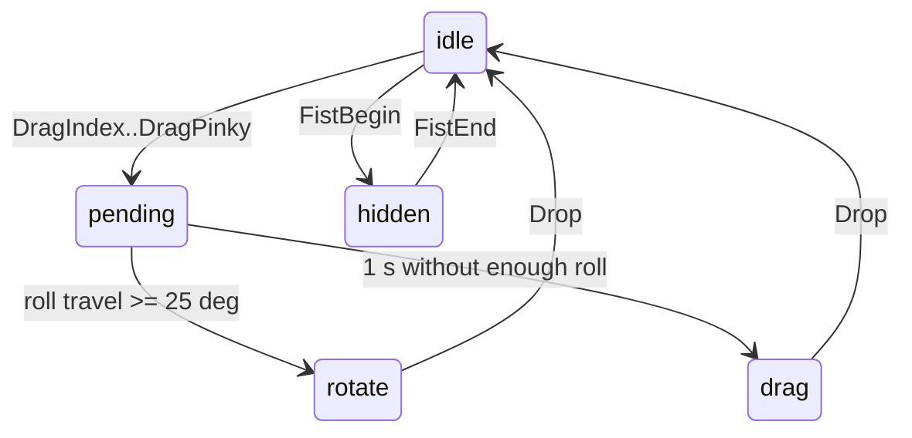

# D-Pad (swipe, pinch, hold to rotate or drag)

**V2 only.** It needs `tapXRAirGestured` and IMU motion. Same interaction as the D-Pad page in the TAP_EV sandbox (https://tapwithus.github.io/TAP_EV/).

The iOS SDK already collapses the raw gesture stream into edges. `Drop` is the release and `FistEnd` is the show, so this controller does not count a run of "none" packets. It still ignores a second copy of the same edge within 40 ms.

## Interaction

| User does | `TAPXRAirGesture` | Event |
|-----------|-------------------|-------|
| Swipe left / right / up / down | `SwipeLeft` 17, `SwipeRight` 18, `SwipeUp` 19, `SwipeDown` 20 | `.direction("left")` and so on |
| Short pinch thumb + index / middle / ring / pinky | `ClickIndex`…`ClickPinky` (1–4) | `.pinch(0...3)`, only when nothing is held |
| Hold a pinch | `DragIndex`…`DragPinky` (5–8) | `.hold(i)`, mode `"pending"` |
| …and twist 25° or more within 1 s | roll from `tapDidChangeOrientation` | `.mode("rotate")`, then `.rotate(degrees)` |
| …and do not twist | — | after 1 s `.mode("drag")`, then `.drag` |
| Relax the hand | `Drop` (9) | `.release(i)` |
| Make a fist / relax the fist | `FistBegin` 14 / `FistEnd` 15 | `.hide` / `.show` |

A repeat of the same swipe, click, drag, or fist-begin within 40 ms is ignored.



## Use the template

Copy [scripts/DpadController.swift](scripts/DpadController.swift). It has no Bluetooth in it. TAPKit-Example compiles that same file into the Knob / D-Pad screen (`GestureSampleViewController`). The example target is Swift 4, and the script stays on that syntax.

- `onGesture(rawValue, now:)` takes `gesture.rawValue` and `ProcessInfo.processInfo.systemUptime` (or any monotonic seconds).
- `onMotion(dx:dy:roll:now:)` takes `moused` deltas and orientation roll.
- `tick(now:)` locks drag if motion packets stop before the window ends.
- `held`, `mode` (`"pending"`, `"rotate"`, `"drag"`, or nil), and `hidden` are the state to draw.

Required device setup, after `start()` and `tapConnected`. Same as the knob: controller mode, model detection, IMU motion, air-gesture model, stream op mode. On TapXR, `setTAPXRState(.airMouse())` covers the vision model.

```swift
private var latestDelta = (dx: 0, dy: 0)

func tapXRAirGestured(identifier: String, gesture: TAPXRAirGesture) {
    apply(dpad.onGesture(gesture.rawValue, now: ProcessInfo.processInfo.systemUptime), identifier)
}

func moused(identifier: String, velocityX: Int16, velocityY: Int16, isMouse: Bool) {
    guard isMouse else { return }
    latestDelta = (Int(velocityX), Int(velocityY))
}

func tapDidChangeOrientation(roll: Int, pitch: Int, yaw: Int) {
    let sample = latestDelta
    latestDelta = (0, 0)
    apply(
        dpad.onMotion(dx: sample.dx, dy: sample.dy, roll: Double(roll), now: ProcessInfo.processInfo.systemUptime),
        nil
    )
}

func apply(_ events: [DpadEvent], _ identifier: String?) {
    for event in events {
        switch event {
        case .direction(let name):
            move(name)
        case .pinch(let index):
            select(index)
            buzz(identifier)
        case .hold(_), .mode(_):
            buzz(identifier)
        case .rotate(let degrees):
            rotate(degrees)
        case .drag(let dx, let dy):
            drag(dx, dy)
        case .release(_):
            snapBack()
        case .hide:
            hideControls()
        case .show:
            showControls()
        }
    }
}

func buzz(_ identifier: String?) {
    guard let identifier else { return }
    TAPKit.sharedKit.vibrate(durations: [40], forIdentifiers: [identifier])
}
```

`move`, `select`, `rotate`, `drag`, `snapBack`, `hideControls`, and `showControls` are the app's own functions. Orientation has no device identifier; keep a single active Tap.

## Tuning

| Argument | Default | Effect |
|----------|---------|--------|
| `rotateLockDegrees` | 25 | Roll travel that chooses rotate. Raise it if drag is chosen too rarely. |
| `lockWindow` | 1.0 | Seconds to decide between rotate and drag. |
| `debounce` | 0.040 | Ignore a repeat of the same edge inside this window. |

- Drag deltas are raw device units. Multiply by a gain (TAP_EV uses about 0.45 points per unit) and clamp to the screen.
- Rotate degrees are relative to the start of the hold. TAP_EV multiplies by about 1.8 for a stronger visual turn.
- If a drag should not stay after release, snap the item back on `.release`.

`PotentialDragOrClick*` (raw 10–13) is ignored. Wait for the click, drag, or drop.

## Ideas

- Four shapes, each selected by its pinch. Hold to rotate or move one of them.
- Menu: swipes move a highlight, `ClickIndex` confirms, `ClickMiddle` goes back, fist closes.
- Photo viewer: swipes change the photo, hold and twist rotates, hold and drag pans.

See also `tapkit-knob` and `tapkit-air-gestures`.
