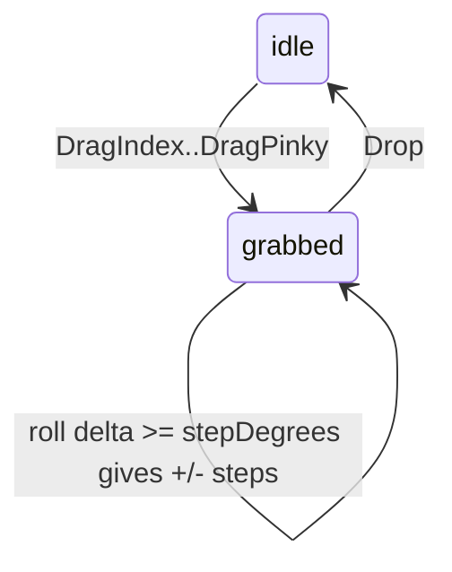

# Knob (pinch-hold + twist)

**V2 only** (TapBand or newer TapXR). It needs air-gesture holds and IMU roll. Legacy v1 hardware does not emit `Drag*` / `Drop` plus orientation together. Same idea as the Knob in the TAP_EV sandbox (https://tapwithus.github.io/TAP_EV/).

## How it works

1. The user holds a pinch. `tapXRAirGestured` fires once with `DragIndex`, `DragMiddle`, `DragRing`, or `DragPinky` (raw 5–8). That **grabs** a knob. Each finger is its own knob, so one hand controls four values.
2. While the pinch is held, `tapDidChangeOrientation` `roll` turns the knob. The roll at the next sample after the grab is the reference. Every `stepDegrees` of roll away from it is one step.
3. The user relaxes. The SDK emits a single `Drop` (raw 9). That **releases** the knob.

iOS does not deliver the repeating raw model codes (100–114) that tap-python-sdk exposes. The SDK has already turned that stream into one drag edge and one drop edge, so there is nothing to debounce and no run of "none" packets to count.



## Use the template

Copy [scripts/KnobTracker.swift](scripts/KnobTracker.swift). It has no Bluetooth in it.

- `onGesture(rawValue)` returns `"start"`, `"release"`, or `nil`. Pass `gesture.rawValue` from `tapXRAirGestured`.
- `onRoll(roll)` returns signed steps, or 0 when idle. Pass `roll` from `tapDidChangeOrientation`.
- `active` is the knob index 0–3 (index, middle, ring, pinky pinch) or `nil`.

Required device setup, after `start()` and `tapConnected`:

```swift
let ids = [identifier]
TAPKit.sharedKit.setTAPInputMode(.controller(), forIdentifiers: ids)
TAPKit.sharedKit.setFeature(.modelDetection, enabled: true, forIdentifiers: ids)
TAPKit.sharedKit.setFeature(.imuMotionData, enabled: true, forIdentifiers: ids)
TAPKit.sharedKit.setVisionSensorModel(.airGesture, forIdentifiers: ids)
TAPKit.sharedKit.setVisionSensorOpMode(.stream, forIdentifiers: ids)
```

On TapXR (hardware version ≥ 40000), `setTAPXRState(.airMouse(), forIdentifiers: ids)` with controller mode is the shorter path. It selects the air-gesture model and leaves IMU motion on.

Wiring:

```swift
func tapXRAirGestured(identifier: String, gesture: TAPXRAirGesture) {
    switch knob.onGesture(gesture.rawValue) {
    case "start":
        TAPKit.sharedKit.vibrate(durations: [40], forIdentifiers: [identifier])
    case "release":
        break
    default:
        break
    }
}

func tapDidChangeOrientation(roll: Int, pitch: Int, yaw: Int) {
    let steps = knob.onRoll(Double(roll))
    guard steps != 0, let index = knob.active else { return }
    values[index] = min(100, max(0, values[index] + steps))
}
```

`tapDidChangeOrientation` has no identifier. Use one Tap for a knob screen.

## Tuning

| Setting | Default | Effect |
|---------|---------|--------|
| `stepDegrees` | 2 | Degrees of roll per step. Larger is slower and more precise. 1–2 for a fine value, 5–10 for menu items. |

- If the direction feels inverted, add `-steps`.
- Buzz once on grab (`vibrate(durations: [40])`). Do not buzz on every step.
- Clamp the value.
- Roll wraps at ±180. `KnobTracker.wrapDegrees` uses the short arc, so crossing the wrap is a few degrees, not a jump of about 360.

## Ideas

- Four properties of one object: index pinch = size, middle = brightness, ring = opacity, pinky = roundness.
- Scroll a list: one step is one row, with `stepDegrees = 8`.

See also `tapkit-dpad` (pinch-hold that chooses rotate or drag) and `tapkit-air-gestures`.
